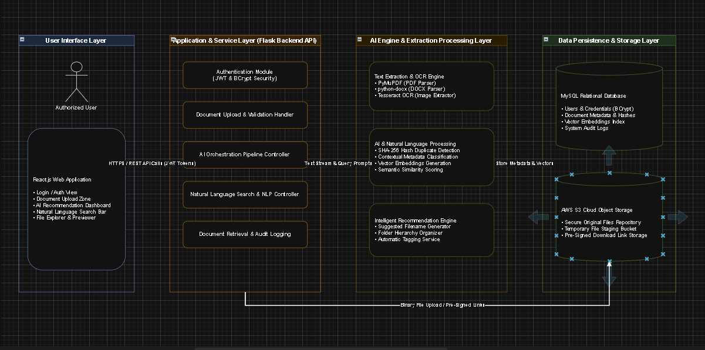

# AI-Powered Personal Digital File Organizer

> An intelligent web application that reads your documents, organises them automatically, and lets you find them by asking in plain English.

**NIT3003 / NIT3004 IT Capstone Project — Group 4, Victoria University**

| | |
|---|---|
| **Status** | ✅ Phase 1 (proposal) and Phase 2 (presentation) complete · ⏳ Phase 3 (implementation, NIT3004) next |
| **Stack** | React.js · Bootstrap · Python Flask · MySQL · AWS S3 · Tesseract OCR · PyMuPDF · python-docx · OpenAI GPT / Hugging Face |
| **Docs** | [`docs/`](docs/README.md) |

---

## The problem

Students and professionals keep thousands of files across laptops and cloud drives. Organising them means creating folders by hand, renaming files, and remembering exact filenames to search. Scanned documents can't be searched at all, and duplicates pile up.

## The solution

Upload a file and the system does the organising:

1. **Extracts the text** from PDF, DOCX, TXT, PNG or JPG (OCR for scans and images)
2. **Understands it with AI** — category, title, keywords and a short summary
3. **Suggests a filename and folder**, e.g. `University ▸ Year 2 ▸ Semester 1 ▸ Database Systems`
4. **Warns about duplicates** — identical files (SHA-256) and edited copies (similarity)
5. **Lets you approve or edit** every suggestion before saving
6. **Finds files by meaning** — *"Find my Semester 1 Database assignment"*

```text
Upload ─► Validate ─► Extract / OCR ─► AI analysis ─► Metadata ─► Duplicate check ─► Review ─► Store ─► Search
```

## Key features

| Feature | Requirement |
|---|---|
| Secure registration and login (BCrypt + JWT) | FR-01 |
| Drag-and-drop multi-format upload | FR-02 |
| AI document classification | FR-03 |
| Automatic title, keywords and summary | FR-04 |
| Filename and folder recommendations | FR-05 |
| Natural-language (semantic) search | FR-06 |
| Exact and similar duplicate detection | FR-07 |
| Secure, per-user storage on AWS S3 | FR-11 |

## Architecture



| Layer | Technology |
|---|---|
| User interface | React.js + Bootstrap |
| API | Python Flask (REST, JSON, JWT) |
| AI and extraction | PyMuPDF, python-docx, Tesseract OCR, OpenAI GPT / Hugging Face |
| Data | MySQL 8 (metadata), AWS S3 (files) |

Details: [System Architecture](docs/04-system-architecture.md) · [Database Design](docs/05-database-design.md) · [API Specification](docs/06-api-specification.md)

## Repository structure

```text
.
├── README.md                  ← you are here
├── CONTRIBUTING.md            ← Git workflow, branches, commits, PRs
├── CHANGELOG.md
├── docs/                      ← all project documentation
│   ├── 01-project-overview.md
│   ├── 02-requirements-specification.md
│   ├── 03-use-cases.md
│   ├── 04-system-architecture.md
│   ├── 05-database-design.md
│   ├── 06-api-specification.md
│   ├── 07-ui-design.md
│   ├── 08-algorithms-pseudocode.md
│   ├── 09-project-plan.md
│   ├── 10-risk-management.md
│   ├── 11-testing-strategy.md
│   ├── 12-references.md
│   └── images/
├── frontend/                  ← React app (Phase 3)
├── backend/                   ← Flask API (Phase 3)
│   └── .env.example
├── database/
│   └── schema.sql             ← MySQL schema
└── .github/
    └── pull_request_template.md
```

## Documentation

| | |
|---|---|
| [Project Overview](docs/01-project-overview.md) | Problem, market, competitors, aim, objectives, scope |
| [Requirements](docs/02-requirements-specification.md) | Functional and non-functional requirements, traceability |
| [Use Cases](docs/03-use-cases.md) | UC-01 to UC-10 |
| [System Architecture](docs/04-system-architecture.md) | Layers, pipeline, sequence diagrams, security |
| [Database Design](docs/05-database-design.md) | ER diagram and tables |
| [API Specification](docs/06-api-specification.md) | REST endpoints (draft) |
| [UI Design](docs/07-ui-design.md) | Screens and prototype screenshots |
| [Algorithms and Pseudocode](docs/08-algorithms-pseudocode.md) | Core procedures |
| [Project Plan](docs/09-project-plan.md) | Team, milestones, Gantt, sprints |
| [Risk Management](docs/10-risk-management.md) | Risk register |
| [Testing Strategy](docs/11-testing-strategy.md) | How every requirement will be tested |
| [References](docs/12-references.md) | APA 7th |

## Getting started

The application code starts in Phase 3. Until then, you can set up the database:

```bash
mysql -u root -p < database/schema.sql
```

Planned setup for each part:

- [Backend setup](backend/README.md) — Python 3.11+, Flask, Tesseract OCR
- [Frontend setup](frontend/README.md) — Node.js 20+, React, Vite

## Project timeline

| Milestone | Description | Status |
|---|---|---|
| M1 | Project proposal completed (NIT3003) | ✅ |
| M2 | Oral presentation (NIT3003) | ✅ |
| M3 | 80% system completion checkpoint (NIT3004) | ⏳ |
| M4 | Final submission and demonstration (NIT3004) | ⏳ |

See the [Project Plan](docs/09-project-plan.md) for the Gantt chart and sprint plan.

## Team

| Name | Student ID |
|---|---|
| Al Shahariar | s8159455 |
| Hassan Zaheer | s8149265 |
| Sebagat Selim | s8131475 |
| Royal Dhakal | s8160992 |

## Contributing

Read [CONTRIBUTING.md](CONTRIBUTING.md) before your first commit. In short: branch from `develop`, use `feature/...` branch names, open a pull request, and get one review before merging.

## Licence

Academic project for Victoria University. No open-source licence has been chosen yet; all rights reserved by the authors.
