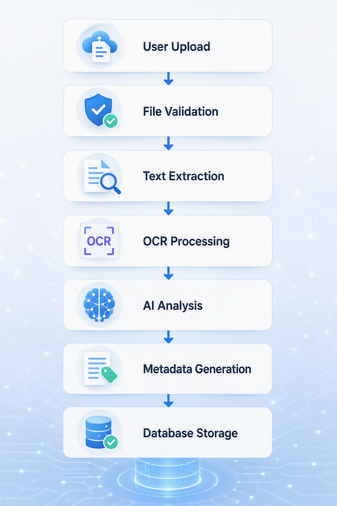

# 1. Project Overview

| | |
|---|---|
| **Project** | Project 4 — AI-Powered Personal Digital File Organizer |
| **Unit** | NIT3003 IT Capstone Project 1 → NIT3004 IT Capstone Project 2 |
| **Institution** | Victoria University |
| **Team** | Group 4 — Al Shahariar, Hassan Zaheer, Sebagat Selim, Royal Dhakal |
| **Source** | Project Proposal (Complete), Sections 1.1 – 1.7 |

---

## 1.1 Background and problem statement

People now keep huge numbers of digital documents — assignments, invoices, resumes, scanned forms — across laptops and cloud drives. As the volume grows, finding the right file gets slower and duplicates and misplaced files become common.

Traditional file management depends on the user to:

- create and maintain folders by hand,
- remember exact filenames to search for them,
- spot and remove duplicate copies themselves.

Scanned documents and images are worse: their text is not searchable at all without OCR.

**The problem in one line:** organising and finding personal documents takes too much manual effort, and filename search fails when users don't remember the exact name.

## 1.2 Proposed solution

A web application that **understands the content** of each uploaded file and organises it automatically. On upload, the system:

1. validates the file (PDF, DOCX, TXT, PNG, JPG),
2. extracts the text (PyMuPDF, python-docx, or Tesseract OCR for images),
3. uses AI/NLP to classify the document and generate a title, keywords, summary, filename and folder path,
4. checks for exact and near-duplicate files,
5. lets the user approve or edit the suggestions,
6. stores the file in AWS S3 and the metadata in MySQL so it can be found later with a natural-language query such as *"Find my Semester 1 Database assignment"*.

```text
Upload ─► Validate ─► Extract text / OCR ─► AI analysis ─► Metadata ─► Duplicate check ─► User review ─► Store ─► Search
```



*Figure 1.1 — Document processing workflow (proposal Figure 2)*

## 1.3 Industry context

- The Intelligent Document Processing (IDP) market is projected to grow roughly 30% a year between 2024 and 2030 (Fortune Business Insights, 2024).
- Organisations are investing heavily in AI for knowledge management and automating repetitive information tasks (IDC, 2024).

Trends supporting this project:

- generative AI used to understand and summarise documents,
- OCR making scanned documents searchable,
- semantic search replacing keyword search,
- wider use of cloud storage by students, professionals and organisations,
- more focus on automating repetitive work.

## 1.4 Competitor analysis

| Product | Strengths | Gaps |
|---|---|---|
| **Google Drive** | Google Workspace integration, secure cloud storage, OCR search, collaboration | Organisation still depends on manual folder creation and naming |
| **Microsoft OneDrive + Copilot** | Microsoft 365 integration, enterprise security, AI summarisation | Many AI features need paid plans; does not auto-classify uploads or build folder structures |
| **Dropbox Dash** | AI semantic search across many connected apps | Focuses on finding files, not organising them or generating metadata |
| **DEVONthink** | Strong local AI classification and indexing | Mainly Apple-only; steep learning curve for ordinary users |

## 1.5 Market gap

Existing tools are good at **storing** and **finding** files, but the user still has to rename files, build folders, add metadata, classify documents and remove duplicates.

This project fills that gap by organising files **at the moment of upload** — combining OCR, NLP, automatic metadata, duplicate detection and folder suggestions in one platform — instead of only helping to search files after the user has organised them.

## 1.6 Aim

Design and build an intelligent web-based file management system that automatically classifies, organises and retrieves a user's documents using AI, NLP and OCR — generating categories, keywords, folder suggestions, summaries and filenames, and supporting natural-language search.

## 1.7 Objectives (SMART)

| # | Objective | Measured by |
|---|---|---|
| O1 | **Multi-format processing and OCR** — build an ingestion pipeline for PDF, DOCX, TXT, PNG and JPG that extracts text, using OCR for images | All five formats extract text correctly in testing (NFR-07) |
| O2 | **Automated AI metadata** — generate category, keywords, summary, title and folder recommendation for every upload | Documents ≤ 20 pages processed within 30 s (NFR-01) |
| O3 | **Natural-language search** — find documents with conversational queries such as *"Find my Year 2 database assignment"* | Results returned within 2 s (NFR-01) |
| O4 | **Duplicate detection** — SHA-256 hashing for identical files plus similarity comparison for edited or related versions | Exact duplicates always detected; similar documents flagged before storage |

## 1.8 Scope

### In scope

- Web-based upload and file management interface
- Cloud storage (AWS S3) for uploaded documents
- PDF, DOCX, TXT, PNG and JPG support
- OCR-based text extraction
- AI document classification
- Keyword and summary generation
- Automatic filename suggestions
- Intelligent folder recommendations
- Natural-language search
- Duplicate file detection
- Secure storage of files and generated metadata
- User authentication and access control

### Out of scope

- Native Android and iOS apps
- Real-time document collaboration
- Audio and video processing
- Direct sync with Dropbox, Google Drive or OneDrive
- Enterprise document workflow management

### Target users

Students, lecturers, office workers, researchers, and anyone who needs to manage personal digital documents efficiently.

### Possible future work

Mobile applications and multilingual document processing (proposal, Section 11).
