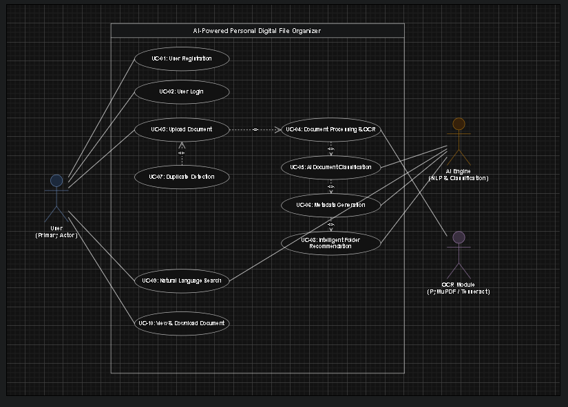

# 3. Use Cases

Source: Project Proposal, Section 4.

## 3.1 Actors

| Actor | Type | Description |
|---|---|---|
| **User** | Primary (human) | Student, lecturer, office worker, researcher or anyone managing personal documents through a web browser |
| **AI Engine** | Secondary (system) | NLP and classification — produces category, metadata and folder suggestions |
| **OCR Module** | Secondary (system) | PyMuPDF / python-docx / Tesseract — turns files into machine-readable text |

Supporting components: React.js web interface, Flask backend, MySQL database, AWS S3 storage, authentication service (JWT + BCrypt).

## 3.2 Use case diagram

*Figure 3.1 — Overall use case diagram (proposal Figure 3)*

## 3.3 Summary

| ID | Use case | Primary actor | Related FRs |
|---|---|---|---|
| UC-01 | User Registration | User | FR-01 |
| UC-02 | User Login | User | FR-01 |
| UC-03 | Upload Document | User | FR-02, FR-08 |
| UC-04 | Document Processing and OCR | System | FR-08, FR-09 |
| UC-05 | AI Document Classification | AI Engine | FR-03, FR-10 |
| UC-06 | Metadata Generation | AI Engine | FR-04, FR-10 |
| UC-07 | Duplicate Detection | System | FR-07 |
| UC-08 | Intelligent Folder Recommendation | AI Engine | FR-05 |
| UC-09 | Natural Language Search | User | FR-06 |
| UC-10 | View and Download Document | User | FR-11 |

---

## UC-01 User Registration

| | |
|---|---|
| **Goal** | Let a new user create a secure account |
| **Actor** | User |
| **Preconditions** | User has internet access; user is not registered |
| **Trigger** | User selects **Register** on the login page |

**Main success scenario**

1. User enters name, email and password.
2. System validates the input, including the password rules (8+ chars, upper, lower, number, special).
3. System checks the email is not already registered.
4. Password is hashed with BCrypt.
5. User record is stored in the database.
6. System shows a success message and redirects to the login page.

**Alternative flows**

- 2a. Required fields empty → show validation message.
- 2b. Password does not meet the rules → show which rule failed; ask for a compliant password.
- 3a. Email already exists → show "An account with this email already exists."

**Postcondition:** a new account exists.
**Quality:** completes within 3 s; password is never stored in plain text.

## UC-02 User Login

| | |
|---|---|
| **Goal** | Authenticate the user before granting access |
| **Actor** | User |
| **Preconditions** | User is registered; server is available |
| **Trigger** | User submits login credentials |

**Main success scenario**

1. User enters email and password.
2. Front end checks required fields.
3. Credentials are sent over HTTPS.
4. Server verifies the BCrypt hash.
5. Server issues a JWT access token.
6. Dashboard is shown.

**Alternative flows:** wrong password · account not found · server unavailable → show a generic "Invalid email or password" (or "Service unavailable") message.

**Postcondition:** the user is on the dashboard with a valid session.
**Quality:** HTTPS only; JWT expires after inactivity.

## UC-03 Upload Document

| | |
|---|---|
| **Goal** | Upload a supported document for AI processing |
| **Actor** | User |
| **Preconditions** | User is logged in; file is a supported format |
| **Trigger** | User selects or drags a file into the upload area |

**Main success scenario**

1. User selects a document.
2. Front end checks type and size.
3. Upload progress is shown.
4. Server receives and validates the file (FR-08), assigns a unique ID and stores it in S3.
5. AI processing starts automatically (UC-04).

**Alternative flows:** unsupported format · file too large · upload interrupted → upload cancelled with an error and a retry option.

**Postcondition:** file is stored and ready for processing.
**Quality:** files < 10 MB confirmed within 3 s on a normal connection.

## UC-04 Document Processing and OCR

| | |
|---|---|
| **Goal** | Extract readable text from the uploaded file |
| **Actor** | System (OCR Module) |
| **Preconditions** | File uploaded successfully |
| **Trigger** | Upload completed |

**Main success scenario**

1. Server identifies the file type.
2. Matching extractor is chosen: PyMuPDF (PDF), python-docx (DOCX), Tesseract (PNG/JPG), direct read (TXT).
3. OCR extracts text from images and scanned pages.
4. Extracted text is checked (not empty, readable).
5. Clean text is passed to AI analysis.

**Alternative flows:** corrupted document · OCR fails · unsupported encoding → status set to `FAILED` with a reason; user is told and can retry or enter details manually.

**Postcondition:** machine-readable text is available for the AI.

## UC-05 AI Document Classification

| | |
|---|---|
| **Goal** | Determine the document's category automatically |
| **Actor** | AI Engine |
| **Preconditions** | Text extraction completed |
| **Trigger** | UC-04 finished |

**Main success scenario**

1. AI receives the extracted text.
2. Document is analysed.
3. Category and subject are predicted.
4. A folder structure is suggested.
5. Classification confidence is recorded.

**Alternative flows:**

- Too little text → mark as "Uncategorised" and ask the user.
- Confidence below threshold → highlight the suggestion as uncertain and ask the user to confirm.
- User edits the suggestion manually.

**Postcondition:** classification is stored.

## UC-06 Metadata Generation

| | |
|---|---|
| **Goal** | Generate useful metadata for the document |
| **Actor** | AI Engine |
| **Preconditions** | Classification completed |
| **Trigger** | AI analysis completed |

**Main success scenario:** AI creates title, keywords, summary, category, suggested filename and folder recommendation. These are shown to the user and saved with the document **after approval**.

**Alternative flow:** user edits the metadata before saving.

**Postcondition:** metadata is available for search and management.

## UC-07 Duplicate Detection

| | |
|---|---|
| **Goal** | Identify duplicate or similar files before permanent storage |
| **Actor** | System |
| **Preconditions** | Document processing completed |
| **Trigger** | Metadata generation completed |

**Main success scenario**

1. SHA-256 hash is calculated.
2. Hash is compared with the user's existing files.
3. Semantic similarity with existing documents is calculated.
4. A duplicate / similar-file warning is shown, linking to the existing file.
5. User decides whether to keep or discard the new upload.

**Alternative flow:** no duplicate found → continue normally.

**Postcondition:** only files the user approves are stored permanently.

> Implementation note: the SHA-256 check is cheap, so it can run straight after upload (before the AI step) to avoid paying for AI analysis on an exact copy. See [Architecture §4.4](04-system-architecture.md#44-document-processing-pipeline).

## UC-08 Intelligent Folder Recommendation

| | |
|---|---|
| **Goal** | Recommend an organised folder hierarchy |
| **Actor** | AI Engine |
| **Preconditions** | Classification completed |
| **Trigger** | Metadata generation completed |

**Main success scenario:** AI suggests a path such as `University ▸ Year 2 ▸ Semester 1 ▸ Database Systems`, reusing the user's existing folders where they match. User approves or edits it.

**Alternative flow:** user changes the suggested folder.

**Postcondition:** approved folder is saved with the document (folders are created if they don't exist yet).

## UC-09 Natural Language Search

| | |
|---|---|
| **Goal** | Find files with conversational queries |
| **Actor** | User |
| **Preconditions** | User has stored documents |
| **Trigger** | User enters a search query |

**Main success scenario**

1. User enters a query, e.g. *"Find my Semester 1 Database assignment"*.
2. Query is converted to a semantic representation (embedding).
3. The user's documents are searched.
4. Results are ranked by relevance.
5. Matching documents are shown with title, category, summary, date and relevance score.

**Alternative flow:** nothing relevant → "No matching documents found. Try rephrasing your search."

**Postcondition:** relevant documents are shown.
**Quality:** results within 2 s.

## UC-10 View and Download Document

| | |
|---|---|
| **Goal** | Let an authorised user open and download a stored file |
| **Actor** | User |
| **Preconditions** | User is authenticated |
| **Trigger** | User selects a stored document |

**Main success scenario**

1. User selects a document from the dashboard or search results.
2. Metadata is displayed.
3. User previews the document.
4. User downloads it if required (short-lived S3 pre-signed URL).
5. Download is recorded in the audit log.

**Alternative flows:** document not found → 404 message · document belongs to someone else → "Access denied".

**Postcondition:** document viewed or downloaded.
**Quality:** only the owner can access the file.
