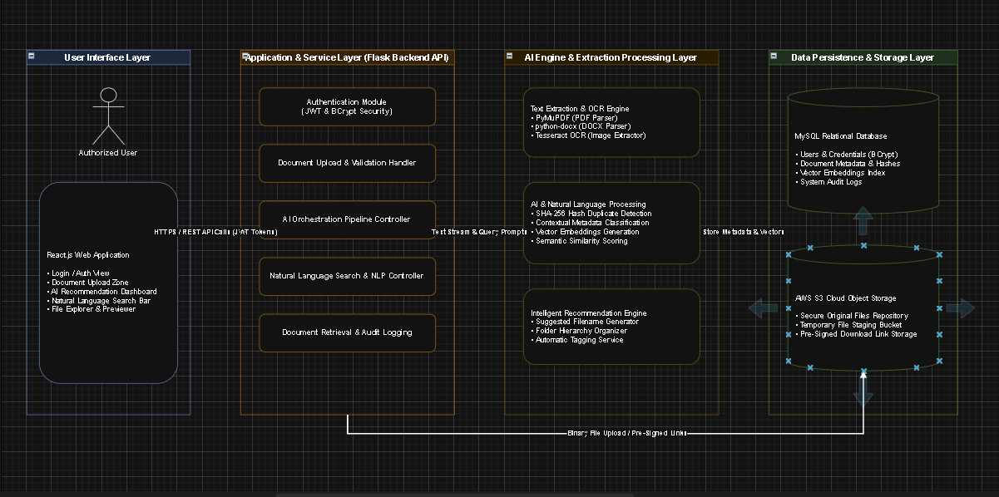
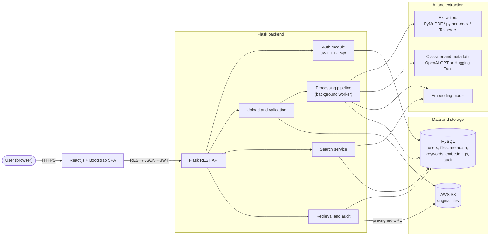
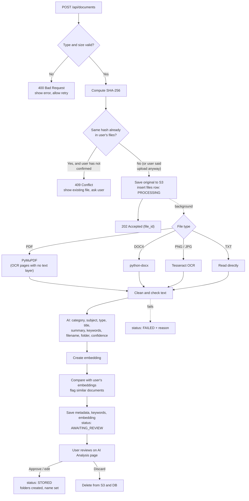
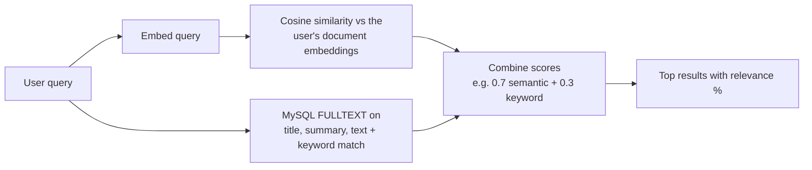
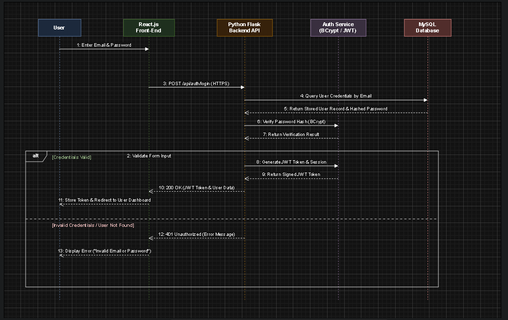
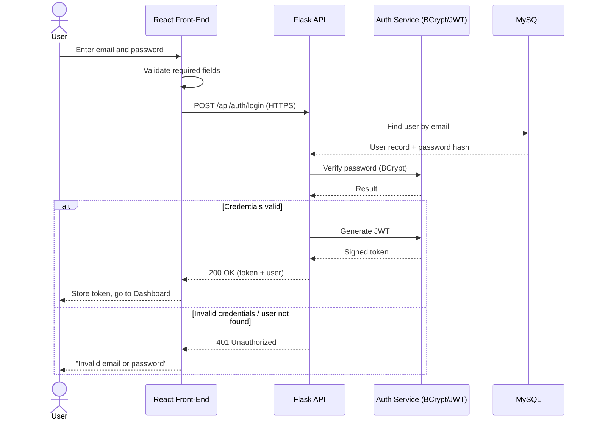
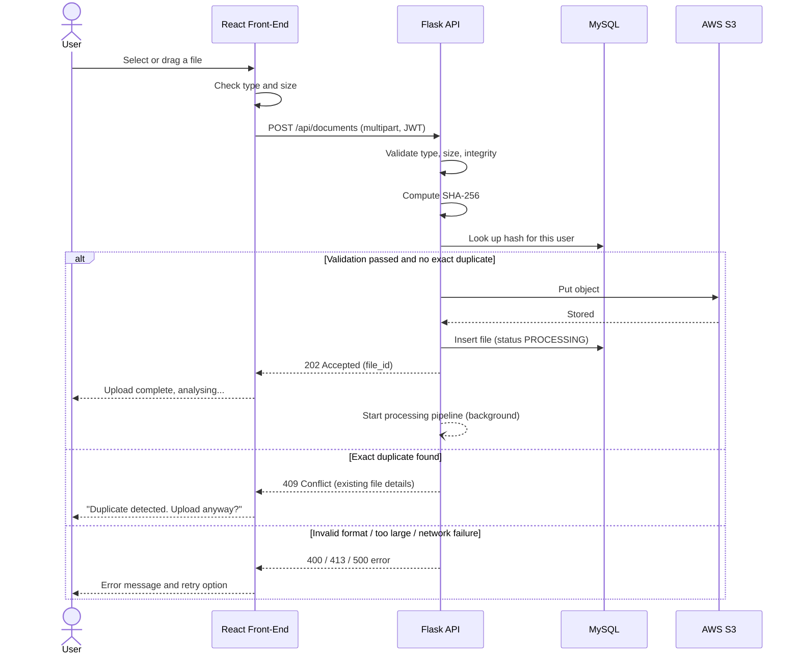
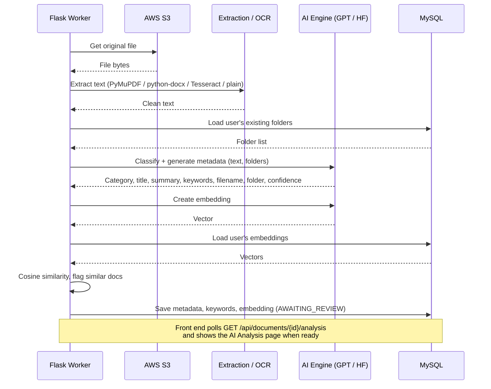
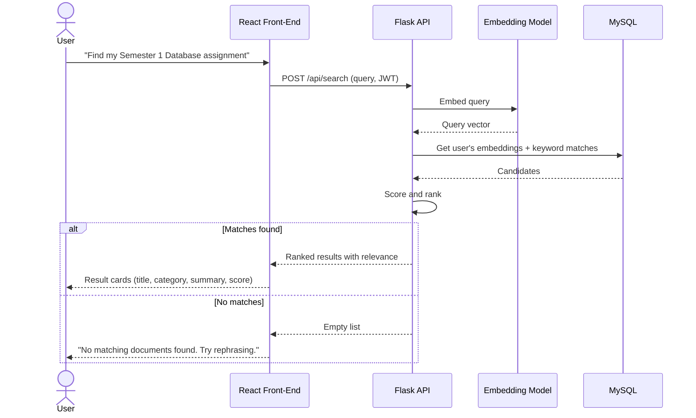
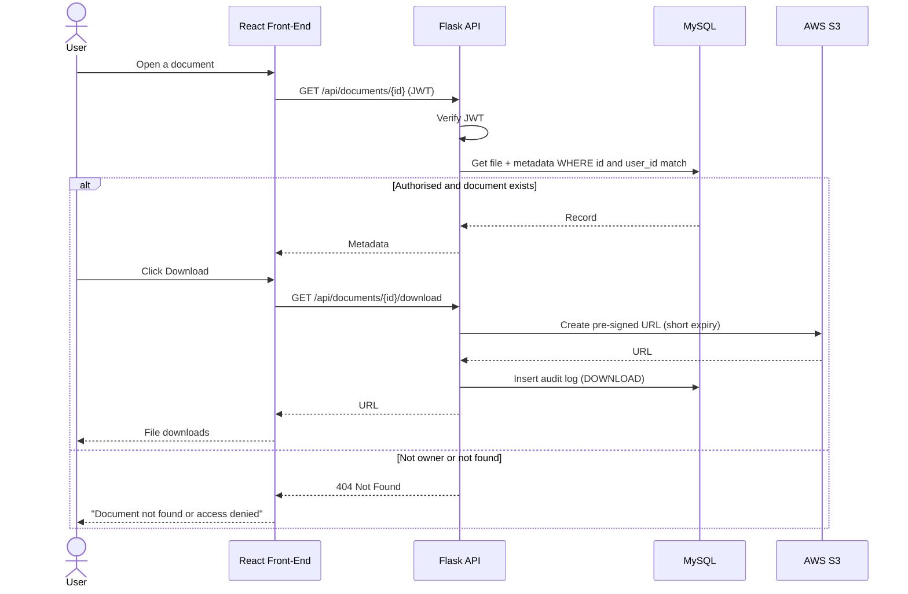

# 4. System Architecture

Source: Project Proposal, Sections 2.4, 5 and 6, plus implementation detail added for Phase 3. Anything marked **(proposed)** is a design decision added in this document and should be confirmed by the team — see [§4.8 Decisions to confirm](#48-decisions-to-confirm).

## 4.1 Overview

The system has four layers:

| Layer | Technology | Responsibility |
|---|---|---|
| **User interface** | React.js + Bootstrap | Login, upload, AI review, search, file browser, settings |
| **Application / API** | Python Flask (REST) | Auth, validation, orchestration of the pipeline, search, retrieval, audit logging |
| **AI and extraction** | PyMuPDF, python-docx, Tesseract OCR, OpenAI GPT / Hugging Face | Text extraction, classification, metadata, embeddings, similarity |
| **Data and storage** | MySQL + AWS S3 | Users, metadata, hashes, embeddings, audit logs (MySQL); original files (S3) |

*Figure 4.1 — Layered architecture (proposal Figure 9)*

## 4.2 Technology stack

| Area | Choice | Why (from proposal §6) |
|---|---|---|
| Front end | React.js, Bootstrap | Reusable components, fast rendering, responsive layout |
| Back end | Python Flask | Lightweight; best fit for Python AI/OCR libraries; quick REST API development |
| Database | MySQL 8 | Reliable, efficient queries, works well with Flask |
| File storage | AWS S3 | Keeps large files out of the database; scalable and redundant |
| PDF text | PyMuPDF | Fast, keeps document structure |
| Word text | python-docx | Standard library for DOCX |
| OCR | Tesseract | Open source, mature (Smith, 2007) |
| AI / NLP | OpenAI GPT and/or Hugging Face models | Classification, summaries, keywords, semantic search |
| Auth | JWT + BCrypt | Stateless tokens; slow, salted password hashing |
| IDE | Visual Studio Code | Team standard, GitHub integration |
| Version control | Git + GitHub | Branch per feature, pull requests, full history |
| Design | Figma (UI), Draw.io (UML) | Shared prototypes and diagrams |

## 4.3 Backend modules

| Module | Responsibility | Requirements |
|---|---|---|
| `auth` | Register, login, JWT issue/verify, password rules | FR-01, FR-11, NFR-02 |
| `validation` | Extension + real content type (magic bytes), size, file opens correctly | FR-08 |
| `extraction` | One extractor per file type; OCR fallback for scanned PDFs | FR-09 |
| `ai` | Classification, metadata, folder/filename suggestion, embeddings | FR-03, FR-04, FR-05, FR-10 |
| `duplicates` | SHA-256 exact match; cosine similarity for near-duplicates | FR-07 |
| `search` | Query embedding, ranking, keyword fallback | FR-06 |
| `storage` | S3 upload, delete, pre-signed download URLs | FR-11, NFR-04 |
| `pipeline` | Runs the steps above for one upload and records status | FR-10, NFR-04 |
| `audit` | Writes `audit_logs` rows | UC-10 |

## 4.4 Document processing pipeline

The upload request returns quickly (NFR-01: confirmation ≤ 3 s). The slow work — OCR and AI — runs in the background **(proposed)** and the front end polls for the result.

**File status values:** `UPLOADED → PROCESSING → AWAITING_REVIEW → STORED`, or `FAILED`.

Design notes:

- **Exact duplicate check first.** Hashing is cheap, so checking it before the AI step avoids paying for analysis of a file the user already has. (The proposal lists it after metadata generation; the result for the user is the same.)
- **Scanned PDFs.** If a PDF page returns almost no text from PyMuPDF, render that page to an image and run Tesseract on it.
- **Text sent to the AI is truncated** to a fixed budget (e.g. the first few thousand words) so 20-page documents stay within the 30 s target (NFR-01) and API cost stays low.
- **The user's existing folder list is sent with the prompt**, so the AI reuses folders such as `University/Year 2` instead of inventing new names each time.
- **AI output is validated** against a fixed JSON shape. Invalid output is retried once, then the document falls back to `Uncategorised` for the user to fill in (UC-05 alternative flow).
- **Error recovery (NFR-04).** AI calls retry up to 3 times with back-off. On start-up the worker re-queues any file left in `PROCESSING` for longer than a few minutes.
- **Storage key vs filename.** S3 objects are stored under an ID-based key (`users/{user_id}/{uuid}`). Renaming a file only changes `generated_name` in MySQL; the download uses that name. No S3 copy is needed.

## 4.5 Search design (proposed)

- Each document's embedding is built from its title, summary, keywords and the start of its text.
- Similarity is computed in Python with NumPy. 10,000 documents × 384 dimensions is about 15 MB per user, which is fast enough for the 2 s target (NFR-01, NFR-05).
- Results are always filtered by `user_id` first (NFR-02 data privacy).

## 4.6 Sequence diagrams

The proposal's Figures 5–8 did not export correctly (all messages overlap on one line), so all five flows are redrawn here. Figure 4 (authentication) is also kept as an image.

### 4.6.1 User authentication

### 4.6.2 Document upload

### 4.6.3 AI document processing

### 4.6.4 Natural language search

### 4.6.5 Document retrieval

> Returning **404** (not 403) for another user's document avoids revealing that the document exists.

## 4.7 Security design

| Threat (OWASP Top 10) | Control |
|---|---|
| Broken access control | Every document query filters by the `user_id` from the JWT; never trust an ID from the client alone |
| Cryptographic failures | HTTPS everywhere; BCrypt (cost ≥ 12) for passwords; secrets only in `.env` |
| Injection | SQLAlchemy ORM / parameterised queries only |
| Insecure design | Upload type checked by content (magic bytes), not just extension; size limit enforced server-side |
| Identification and authentication failures | Password rules (FR-01); generic login error message; JWT expiry; rate-limit login attempts **(proposed)** |
| Security misconfiguration | S3 bucket is private; files only reachable through short-lived pre-signed URLs |
| Logging and monitoring | `audit_logs` table for login, upload, download, delete |

**Privacy note:** if OpenAI is used, document text is sent to a third-party API. The app should say so in its privacy notice, and the team may prefer a local Hugging Face model for sensitive documents.

## 4.8 Decisions to confirm

These were left open in the proposal. Agree them at the first NIT3004 team meeting and record the choice here.

| # | Decision | Options | Suggested default |
|---|---|---|---|
| D1 | Model for classification and metadata | OpenAI GPT (API) · Hugging Face model (local) | OpenAI for accuracy; keep the interface swappable (NFR-05) |
| D2 | Embedding model | `all-MiniLM-L6-v2` (local, free, 384-dim) · OpenAI embeddings | `all-MiniLM-L6-v2` |
| D3 | Background processing | Thread pool inside Flask · Celery + Redis | Thread pool first; Celery if time allows |
| D4 | Where the browser keeps the JWT | httpOnly cookie · memory / localStorage | httpOnly cookie (safer against XSS) |
| D5 | Maximum upload size | 10 MB · 20 MB · other | 20 MB (configurable via `MAX_UPLOAD_MB`) |
| D6 | Session timeout | 15 · 30 · 60 min | 30 min |
| D7 | Name fields | Single `name` (proposal DB) · first + last name (UI mock-up) | Single `name`; UI joins first + last |
| D8 | Hosting for final demo | Local machine · AWS EC2 · other | Decide by Milestone 3 |
