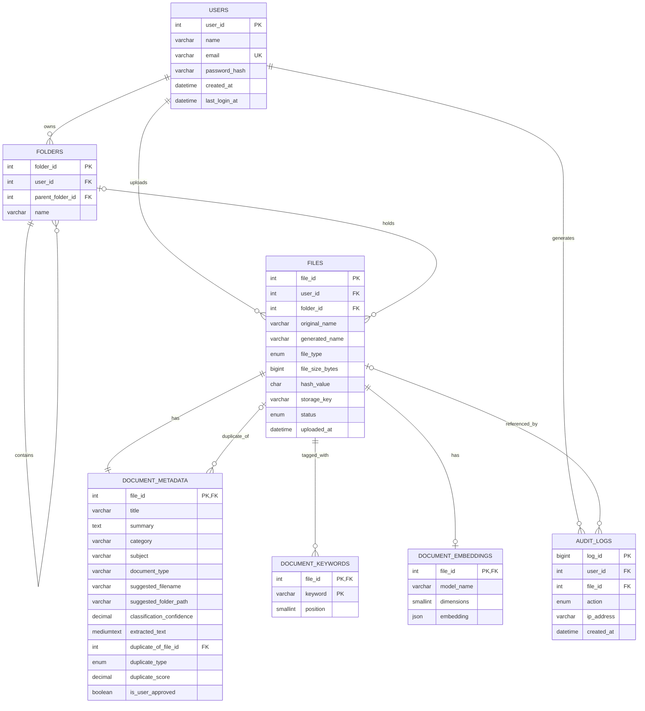

# 5. Database Design

Source: Project Proposal, Section 2.3, extended for implementation. The runnable script is [`database/schema.sql`](../database/schema.sql).

- **MySQL 8** (InnoDB, `utf8mb4`) holds users, file records, AI metadata, keywords, embeddings and audit logs.
- **AWS S3** holds the original files. MySQL stores only the S3 key.

## 5.1 What changed from the proposal

The proposal defined three tables: **User**, **File** and **Document Metadata** (the Document Metadata table was left empty). This design keeps those three, fills in Document Metadata, and adds four tables the features need:

| Table | Source | Why it's needed |
|---|---|---|
| `users` | Proposal | Accounts (FR-01) |
| `files` | Proposal | One row per uploaded file (FR-02, FR-07, FR-08) |
| `document_metadata` | Proposal (columns defined here) | AI output and user approval (FR-03, FR-04, FR-05) |
| `folders` | **Added** | The user's folder tree for recommended paths (FR-05) |
| `document_keywords` | **Added** | One row per keyword so search can match keywords (FR-04, FR-06) |
| `document_embeddings` | **Added** | Vectors for semantic search and near-duplicate detection (FR-06, FR-07) |
| `audit_logs` | **Added** | "Download activity is recorded for auditing" (UC-10) |

## 5.2 Entity-relationship diagram

## 5.3 Table definitions

### `users`

| Column | Type | Notes | Example |
|---|---|---|---|
| `user_id` | INT, PK, auto | | 1001 |
| `name` | VARCHAR(150) | Full name | Al Shahariar |
| `email` | VARCHAR(255), unique | Login ID | user@example.com |
| `password_hash` | VARCHAR(255) | BCrypt hash only | `$2b$12$…` |
| `created_at` / `updated_at` | DATETIME | | 2026-03-01 10:00 |
| `last_login_at` | DATETIME, null | | |

### `files`

| Column | Type | Notes | Example |
|---|---|---|---|
| `file_id` | INT, PK, auto | | 501 |
| `user_id` | INT, FK → users | Owner | 1001 |
| `folder_id` | INT, FK → folders, null | Set on approval | 12 |
| `original_name` | VARCHAR(255) | As uploaded | `assignment.pdf` |
| `generated_name` | VARCHAR(255), null | Approved name | `Database_Assignment.pdf` |
| `file_type` | ENUM | PDF, DOCX, TXT, PNG, JPG | PDF |
| `mime_type` | VARCHAR(100) | Detected from content | `application/pdf` |
| `file_size_bytes` | BIGINT | Stored in bytes (the proposal's "2500 KB" = 2,560,000) | 2560000 |
| `hash_value` | CHAR(64) | SHA-256 hex | `9f86d0…` |
| `storage_key` | VARCHAR(512) | S3 object key | `users/1001/4b1e…` |
| `status` | ENUM | UPLOADED, PROCESSING, AWAITING_REVIEW, STORED, FAILED | STORED |
| `error_message` | VARCHAR(500), null | Reason when FAILED | |
| `uploaded_at` / `updated_at` | DATETIME | | |

### `document_metadata`

| Column | Type | Notes | Example |
|---|---|---|---|
| `file_id` | INT, PK + FK → files | One-to-one with files | 501 |
| `title` | VARCHAR(255) | | Network Technologies Assignment Report |
| `summary` | TEXT | | A university report on IPv6… |
| `category` | VARCHAR(100) | Top-level category | University |
| `subject` | VARCHAR(150) | | Database Systems |
| `document_type` | VARCHAR(100) | | Assignment |
| `suggested_filename` | VARCHAR(255) | AI suggestion | `Semester1_Database_Systems_Assignment.pdf` |
| `suggested_folder_path` | VARCHAR(500) | AI suggestion, `/`-separated | `University/Year 2/Semester 1/Database Systems` |
| `classification_confidence` | DECIMAL(5,4) | 0–1 | 0.9120 |
| `extracted_text` | MEDIUMTEXT | Up to 16 MB of text | |
| `extraction_method` | ENUM | PYMUPDF, PYTHON_DOCX, TESSERACT_OCR, PLAIN_TEXT | PYMUPDF |
| `ai_model` | VARCHAR(100) | Which model produced it | |
| `is_user_approved` | BOOLEAN | FR-05 approval | true |
| `approved_at` | DATETIME, null | | |
| `duplicate_of_file_id` | INT, FK → files, null | Closest existing copy found when the file was processed | 233 |
| `duplicate_type` | ENUM, null | EXACT (same SHA-256) or SIMILAR (embedding similarity ≥ threshold) | SIMILAR |
| `duplicate_score` | DECIMAL(5,4), null | 1.0 for EXACT, cosine similarity for SIMILAR | 0.9754 |

The keyword part of search is computed in Python (see [Architecture §4.5](04-system-architecture.md#45-search-design)), so no `FULLTEXT` index is needed.

### `folders`

| Column | Type | Notes |
|---|---|---|
| `folder_id` | INT, PK, auto | |
| `user_id` | INT, FK → users | Owner |
| `parent_folder_id` | INT, FK → folders, null | `NULL` = top level |
| `name` | VARCHAR(150) | e.g. `Year 2` |

Folder names are unique among siblings. MySQL treats `NULL` values as distinct in unique keys, so the backend also checks for duplicate **top-level** folder names (case-insensitive) before creating one.

### `document_keywords`

| Column | Type | Notes |
|---|---|---|
| `file_id` | INT, FK → files | |
| `keyword` | VARCHAR(100) | e.g. `IPv6` |
| `position` | SMALLINT | Keeps the order the AI or user gave the keywords |

Primary key is `(file_id, keyword)`. Keywords are de-duplicated case-insensitively.

### `document_embeddings`

| Column | Type | Notes |
|---|---|---|
| `file_id` | INT, PK + FK → files | |
| `model_name` | VARCHAR(150) | e.g. `all-MiniLM-L6-v2` — re-embed if the model changes |
| `dimensions` | SMALLINT | 512 for the default local embeddings, 384 for MiniLM, 1536 for OpenAI |
| `embedding` | JSON | Array of floats |

MySQL 8 has no vector type, so similarity is computed in Python. If the project later moves to MySQL 9 (`VECTOR` type) or a vector database, only this table and the search service change (NFR-05).

### `audit_logs`

| Column | Type | Notes |
|---|---|---|
| `log_id` | BIGINT, PK, auto | |
| `user_id` | INT, FK → users | |
| `file_id` | INT, FK → files, null | Kept as `NULL` if the file is later deleted |
| `action` | ENUM | REGISTER, LOGIN, LOGIN_FAILED, UPLOAD, APPROVE, VIEW, DOWNLOAD, UPDATE, MOVE, DELETE, SEARCH |
| `details` | VARCHAR(500), null | |
| `ip_address` | VARCHAR(45), null | IPv4 or IPv6 |
| `created_at` | DATETIME | |

## 5.4 Key rules

- **Ownership:** every query on `files` and related tables includes `user_id = <id from JWT>`.
- **Deleting a user** deletes their folders, files, metadata, keywords, embeddings and logs (`ON DELETE CASCADE`). Their S3 objects must be deleted by the backend.
- **Deleting a file** deletes its metadata, keywords and embedding; audit rows stay with `file_id = NULL`.
- **Exact duplicate lookup** uses the `(user_id, hash_value)` index. It is not unique, because the user may choose to keep a duplicate.
- **Normalisation:** keywords and folders live in their own tables (3NF) so they can be searched and renamed without editing every file (NFR-06).

## 5.5 Backups (NFR-04)

- Nightly `mysqldump` of the database during testing, kept for 7 days.
- S3 versioning switched on for the bucket so overwritten or deleted files can be recovered.
