# 7. UI Design

Source: Project Proposal, Section 8. Prototypes were designed in Figma and are now built with React.js and Bootstrap in [`frontend/`](../frontend/README.md). The app is called **FileAI — "Organize smarter with AI"**.

## Implemented screens (v0.1)

Screenshots from the running app (real backend and MySQL, demo account):

| Dashboard | AI analysis and review |
|---|---|
| 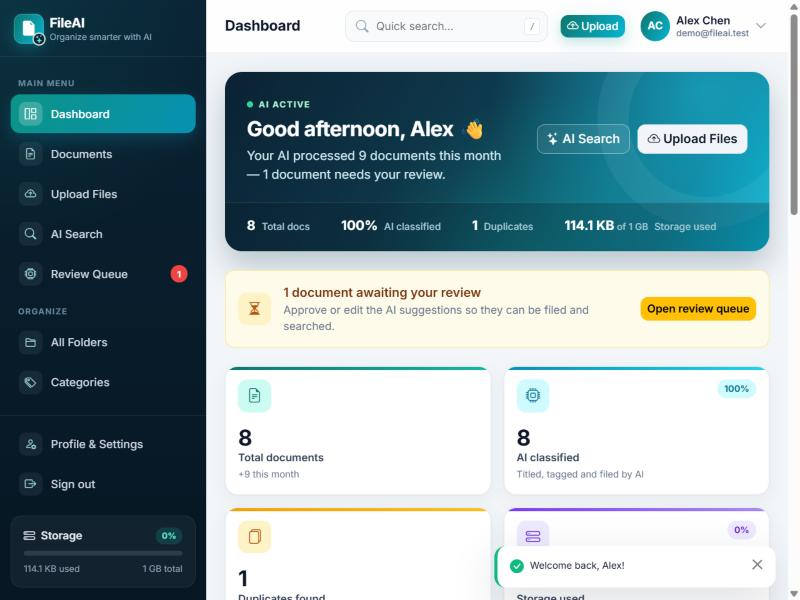 | 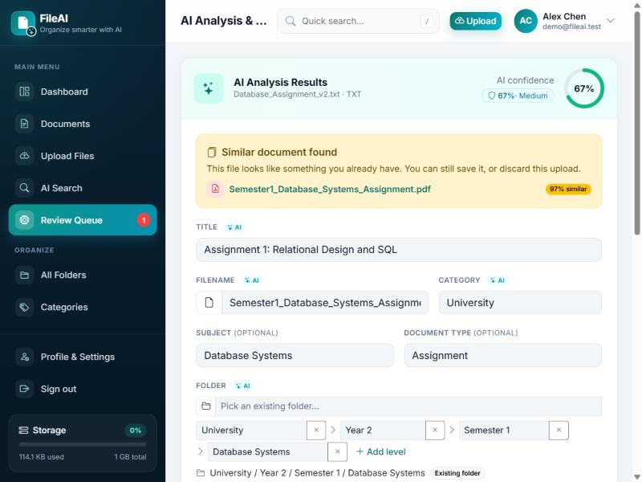 |
| **Natural-language search** | **Upload queue** |
| 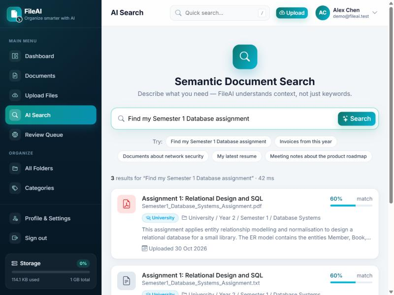 | 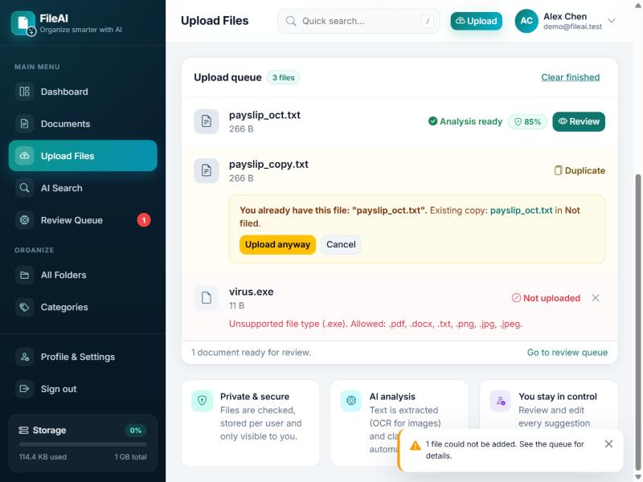 |

Additions beyond the prototype:

- **Review Queue** page (`/review`) listing documents awaiting review, failed and still processing, with a count badge in the sidebar.
- **Documents**, **All Folders** and **Categories** pages for browsing.
- Duplicate and invalid-file handling directly in the upload queue ("Upload anyway" / "Cancel").
- Confidence ring and similar-document warning on the review page; "Retry processing" for failed files.
- The prototype's "Pro Plan / Upgrade Storage" elements were left out (not in scope); the sidebar shows storage used against the quota instead.

## 7.1 Design principles

- **Consistent layout:** left sidebar navigation, top bar with quick search, upload button and profile menu on every signed-in page.
- **Responsive:** works on desktop and laptop screens (NFR-07).
- **Accessible:** readable fonts, strong colour contrast, clear error messages (Nielsen, 1994; NFR-03).
- **User stays in control:** every AI suggestion can be edited before it's saved (FR-05).

## 7.2 Screen map

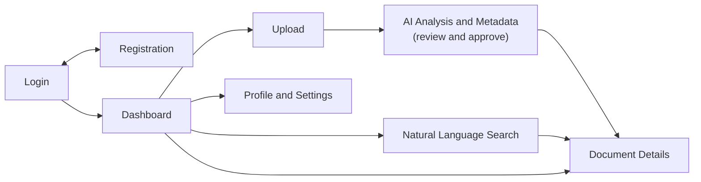

## 7.3 Screens

| # | Screen | Purpose | Key elements | FR / UC | Route |
|---|---|---|---|---|---|
| 1 | Login | Secure sign-in | Email, password (masked), Login button, Create Account link, validation messages | FR-01 / UC-02 | `/login` |
| 2 | Registration | Create an account | First name, last name, email, password + confirm, password-strength hints | FR-01 / UC-01 | `/register` |
| 3 | Dashboard | Overview and quick actions | Stat cards (total docs, AI classified, duplicates, storage), upload activity chart, AI activity feed, quick AI search | — | `/` |
| 4 | Document Upload | Add files | Drag-and-drop zone, file picker, supported formats, progress bar, status messages | FR-02 / UC-03 | `/upload` |
| 5 | AI Analysis and Metadata | Review AI output | Suggested title, keywords, summary, category, filename, folder path; duplicate warning; Accept / Edit buttons | FR-03–FR-05, FR-07 / UC-05–UC-08 | `/documents/:id/review` |
| 6 | Natural Language Search | Find files by meaning | Conversational search box, result cards with name, category, summary, date, relevance score | FR-06 / UC-09 | `/search` |
| 7 | Document Details | Inspect and manage one file | Preview, AI metadata, category, keywords, path, duplicate status; Edit, Rename, Move, Download, Delete | UC-10 | `/documents/:id` |
| 8 | Profile and Settings | Manage account | Profile info, change password, notifications, security options, storage usage | — | `/settings` |

## 7.4 Prototype screenshots

### Login
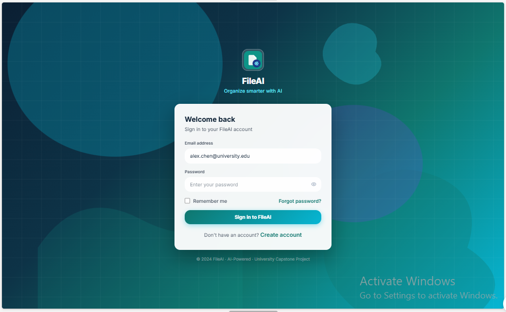

### Registration
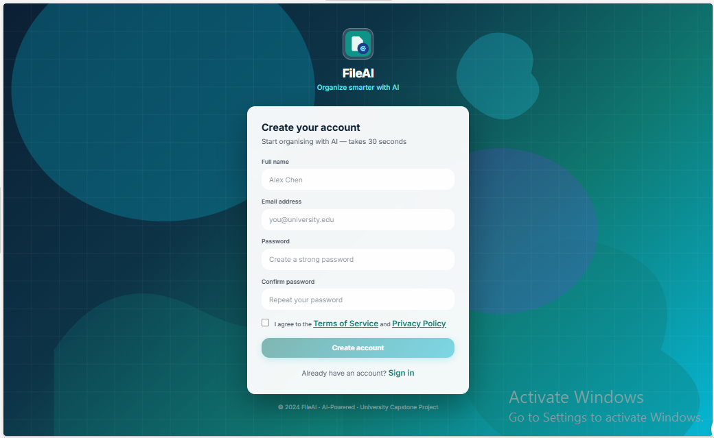

### Dashboard
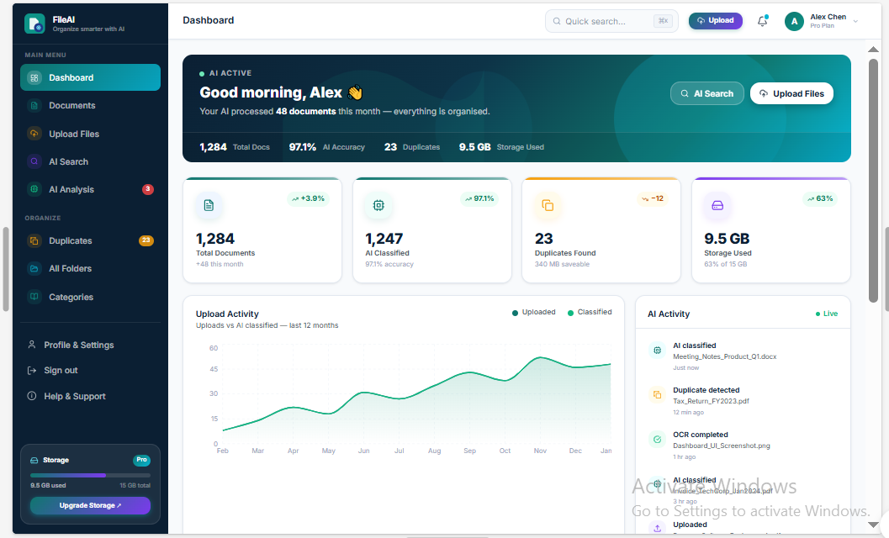

### Document upload
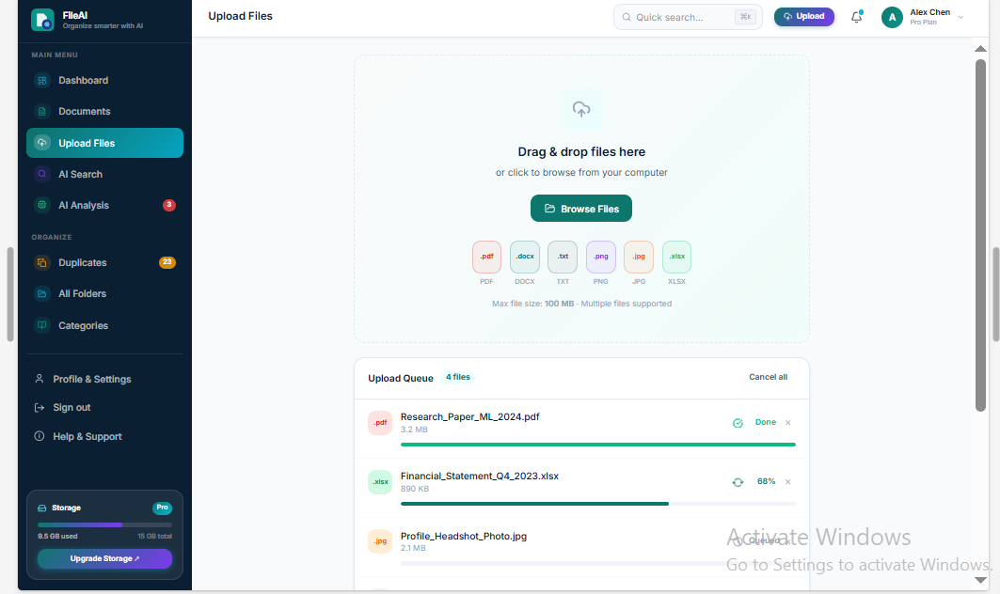

### AI analysis and metadata
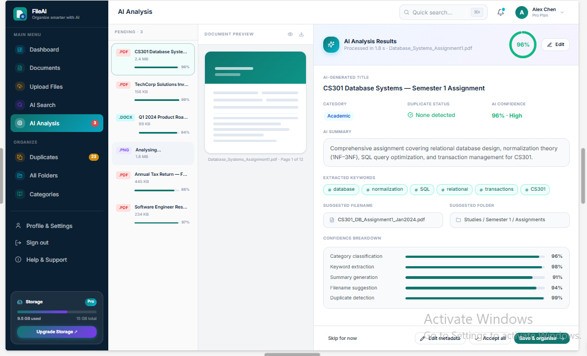

### Natural language search
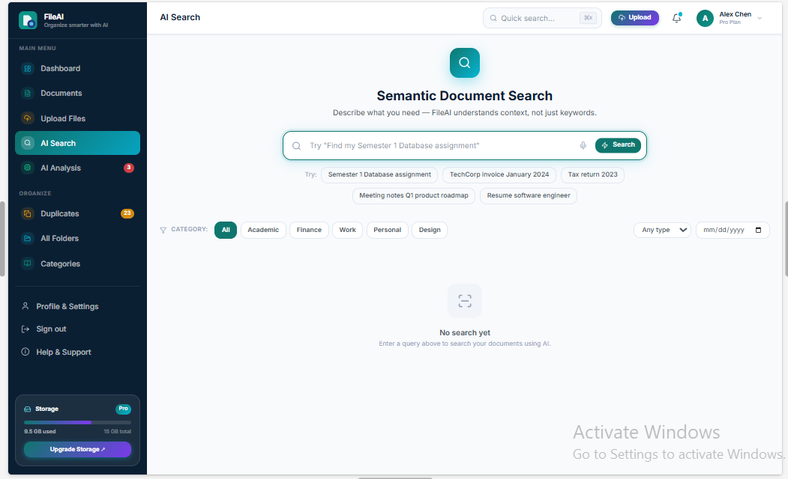

### Document details
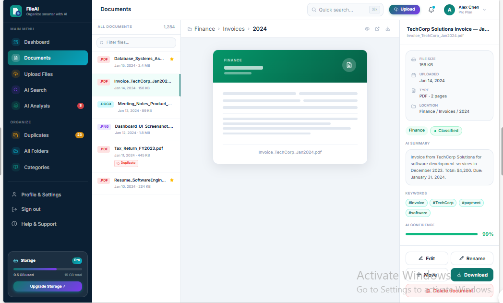

### Profile and settings
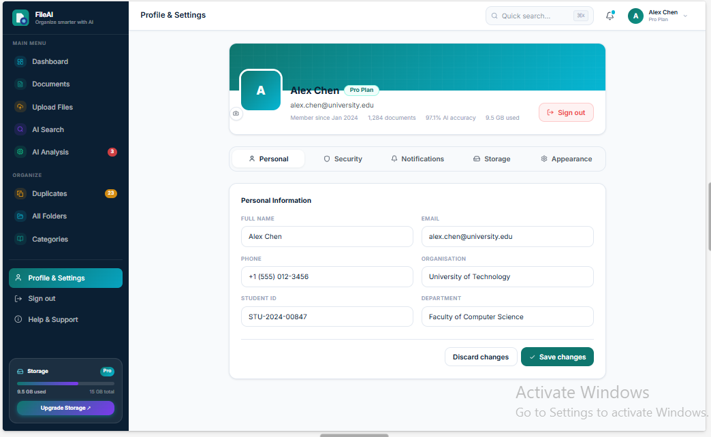

## 7.5 Notes for implementation

- **Mock-up data is illustrative.** Numbers like "1,284 documents" or "97.1% AI accuracy" come from the prototype; in the real app they come from `GET /api/dashboard/stats`.
- **"Pro Plan" / "Upgrade Storage"** in the prototype imply paid tiers, which are not in the project scope. Show storage usage only, or agree a fixed quota.
- **Upload → review flow:** after upload, show a "Analysing…" state while polling `GET /api/documents/{id}/analysis`, then open the review screen.
- **Low-confidence suggestions** (below the threshold in `.env`) should be visually marked so users check them.
- **Registration fields:** the mock-up has first and last name; the database stores one `name` (decision D7 in [Architecture §4.8](04-system-architecture.md#48-decisions-to-confirm)).
