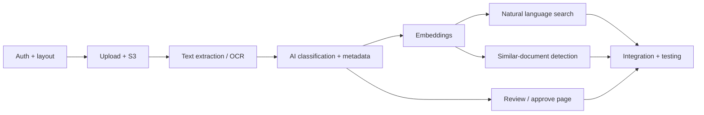

# 9. Project Plan

Source: Project Proposal, Sections 6 (Resource Management) and 10 (Timeline), plus a proposed sprint plan for the implementation semester.

## 9.1 Team

| Member | Student ID | Phase 1 contributions (proposal) |
|---|---|---|
| Al Shahariar | s8159455 | Use case modelling, sequence diagrams, UI design, timeline and Gantt chart, report integration, formatting, referencing |
| Hassan Zaheer | s8149265 | Resource management, risk management, methodology, hardware/software planning, research, proofreading |
| Sebagat Selim | s8131475 | Pseudocode, UI design, AI workflow documentation, document processing logic, research |
| Royal Dhakal | s8160992 | Sequence diagram validation, implementation planning, timeline review, documentation, technical review |

Each member contributed **25%** to the proposal.

### Phase 3 responsibilities (to be agreed)

| Area | Lead | Support |
|---|---|---|
| Front end (React.js) | _TBD_ | _TBD_ |
| Back end (Flask API, auth, storage) | _TBD_ | _TBD_ |
| Database (MySQL) | _TBD_ | _TBD_ |
| AI and OCR pipeline | _TBD_ | _TBD_ |
| Testing and QA | _TBD_ | _TBD_ |
| Documentation and presentation | All | All |

## 9.2 Methodology — Agile

The project follows an **Agile, iterative** approach (Pressman & Maxim, 2020; Sommerville, 2016):

- Work in short sprints; each sprint delivers something that can be demonstrated and tested.
- **Weekly team meeting**: progress, blockers, next tasks, risk review.
- Supervisor feedback is fed into the next sprint.
- Tasks tracked as GitHub Issues on a GitHub Project board (To do → In progress → In review → Done).

**Definition of Done** for a task:

1. Meets the acceptance criteria of its FR / use case.
2. Code reviewed and approved in a pull request by at least one other member.
3. Tests written and passing.
4. Documentation updated if behaviour or API changed.
5. Merged into `develop`.

## 9.3 Phases and milestones

| Phase | Unit | Content | Milestone | Status |
|---|---|---|---|---|
| 1 — Proposal, planning and design | NIT3003 | Research, requirements, use cases, sequence diagrams, DB design, pseudocode, UI design, risk plan, timeline | **M1** Project proposal completed | ✅ Done |
| 2 — Oral presentation | NIT3003 | Present the design to supervisor and class; collect feedback | **M2** Oral presentation | ✅ Done |
| 3 — System implementation | NIT3004 | React front end, Flask back end, MySQL, OCR and AI modules, integration | **M3** 80% system completion checkpoint | ⏳ Next |
| 4 — Testing, documentation, delivery | NIT3004 | Full testing, bug fixing, UI polish, final docs, demo | **M4** Final submission and demonstration | ⏳ Planned |

**Dependencies** (from the proposal): AI analysis needs working text extraction/OCR first; natural-language search needs metadata generation and the database first.



## 9.4 Timeline (proposal Gantt chart, 16 weeks)

```text
                                               1  2  3  4  5  6  7  8  9 10 11 12 13 14 15 16
T1  Project planning & requirements analysis  ██ ██ ·  ·  ·  ·  ·  ·  ·  ·  ·  ·  ·  ·  ·  ·
T2  System analysis & design (UML, database)  ·  ██ ██ ██ ·  ·  ·  ·  ·  ·  ·  ·  ·  ·  ·  ·
T3  UI/UX design (Figma)                      ·  ·  ██ ██ ██ ·  ·  ·  ·  ·  ·  ·  ·  ·  ·  ·
T4  Front-end development (React.js)          ·  ·  ·  ·  ██ ██ ██ ██ ██ ·  ·  ·  ·  ·  ·  ·
T5  Back-end development (Flask API)          ·  ·  ·  ·  ██ ██ ██ ██ ██ ██ ·  ·  ·  ·  ·  ·
T6  Database development (MySQL)              ·  ·  ·  ·  ·  ██ ██ ██ ██ ·  ·  ·  ·  ·  ·  ·
T7  AI integration (OCR, NLP, metadata)       ·  ·  ·  ·  ·  ·  ·  ██ ██ ██ ██ ██ ·  ·  ·  ·
T8  NL search & duplicate detection           ·  ·  ·  ·  ·  ·  ·  ·  ·  ██ ██ ██ ██ ·  ·  ·
T9  System integration & testing              ·  ·  ·  ·  ·  ·  ·  ·  ·  ·  ·  ██ ██ ██ ██ ·
T10 Documentation, presentation, submission   ·  ·  ·  ·  ·  ·  ·  ·  ·  ·  ·  ·  ·  ██ ██ ██
```

| ID | Activity | Owner | Start (wk) | Finish (wk) |
|---|---|---|---|---|
| T1 | Project planning and requirements analysis | All | 1 | 2 |
| T2 | System analysis and design (use case, UML, database) | All | 2 | 4 |
| T3 | UI/UX design (Figma) | All | 3 | 5 |
| T4 | Front-end development (React.js) | Team | 5 | 9 |
| T5 | Back-end development (Python Flask API) | Team | 5 | 10 |
| T6 | Database development (MySQL) | Team | 6 | 9 |
| T7 | AI integration (OCR, NLP and metadata) | Team | 8 | 12 |
| T8 | Natural language search and duplicate detection | Team | 10 | 13 |
| T9 | System integration and testing | All | 12 | 15 |
| T10 | Documentation, presentation and final submission | All | 14 | 16 |

T1–T3 were completed in NIT3003. T4–T10 are carried out in NIT3004 and are broken into sprints below.

## 9.5 Proposed sprint plan for NIT3004

Two-week sprints. Fill in real dates once the semester calendar is known.

| Sprint | Dates | Goal | Requirements | Gantt tasks |
|---|---|---|---|---|
| 0 (setup, 1 wk) | _TBD_ | Repo, branches, dev environments, MySQL schema, private S3 bucket, Flask and React skeletons; agree decisions D1–D8 | NFR-06 | T5, T6 |
| 1 | _TBD_ | Register, login, JWT, protected routes; app layout (sidebar, top bar) | FR-01, FR-11 | T4, T5 |
| 2 | _TBD_ | Upload page, validation, S3 storage, SHA-256 exact duplicates, text extraction + OCR | FR-02, FR-07 (exact), FR-08, FR-09 | T4, T5, T7 |
| 3 | _TBD_ | AI classification, metadata, filename and folder suggestions; AI Analysis review page; approve flow; folders | FR-03, FR-04, FR-05, FR-10 | T7 |
| 4 | _TBD_ | Embeddings, similar-document detection, natural-language search + search page — **M3: 80% checkpoint** | FR-06, FR-07 (similar) | T8 |
| 5 | _TBD_ | Document details (edit, move, download, delete), dashboard stats, profile and settings, audit log, security hardening | UC-10, NFR-02 | T4, T5 |
| 6 | _TBD_ | Performance, usability and security testing; bug fixes; final documentation and demo — **M4** | NFR-01 – NFR-07 | T9, T10 |

## 9.6 Resources

### Hardware (per team member)

- Intel Core i5 / AMD Ryzen 5 or better
- 16 GB RAM
- 512 GB SSD
- Windows 11 or macOS
- Stable broadband internet

### Software and services

| Category | Tools |
|---|---|
| Front end | React.js, Bootstrap |
| Back end | Python, Flask |
| Database | MySQL 8 |
| Document processing | Tesseract OCR, PyMuPDF, python-docx |
| AI | OpenAI GPT and/or Hugging Face models |
| Cloud | AWS S3 |
| IDE | Visual Studio Code |
| Collaboration | Git, GitHub (code, issues, project board, pull requests) |
| Design | Figma (UI), Draw.io (UML) |

### Resource use across the SDLC

| Stage | Resources used |
|---|---|
| Planning and analysis | Figma, Draw.io |
| Development | VS Code, GitHub, React.js, Bootstrap, Flask |
| AI and processing | Tesseract, PyMuPDF, python-docx, OpenAI / Hugging Face |
| Storage | MySQL, AWS S3 |
| Testing and deployment | All of the above + test tools in [Testing Strategy](11-testing-strategy.md) |
